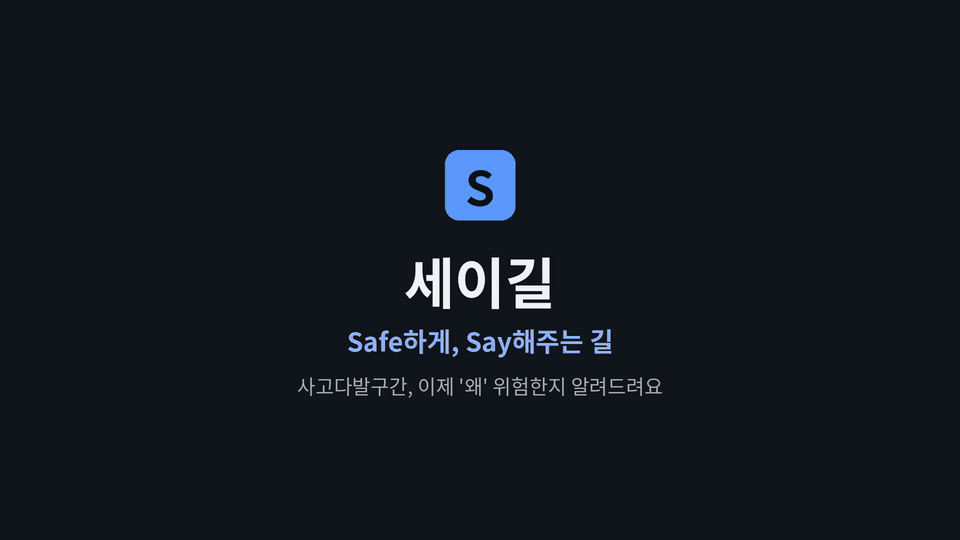
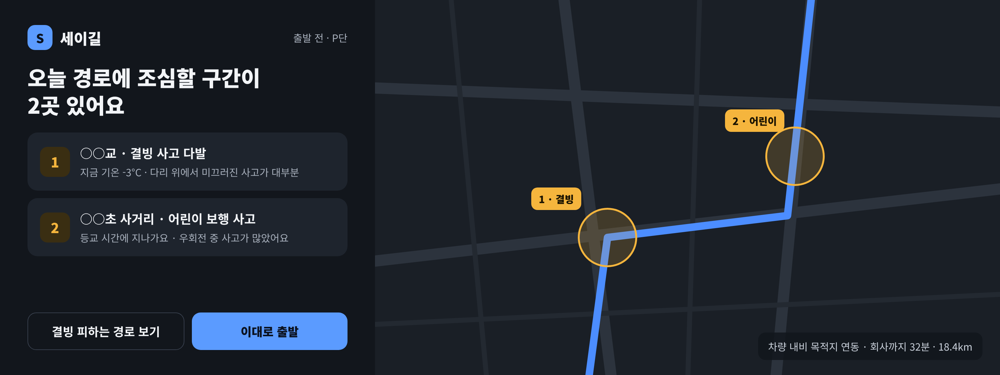
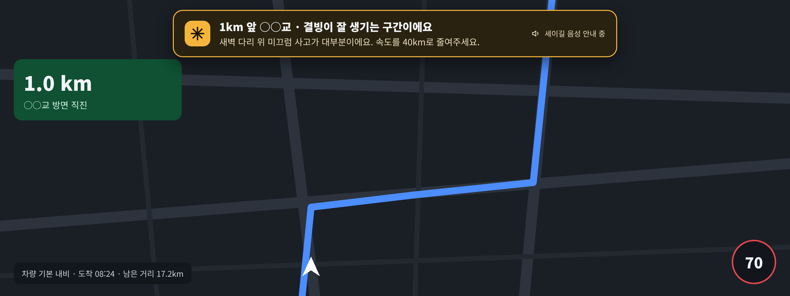
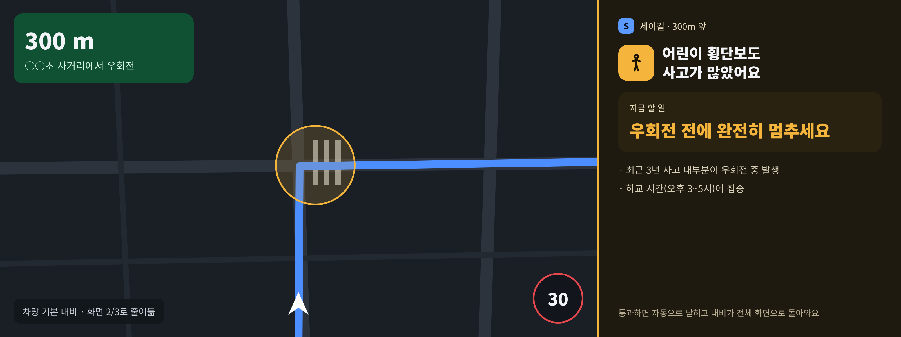
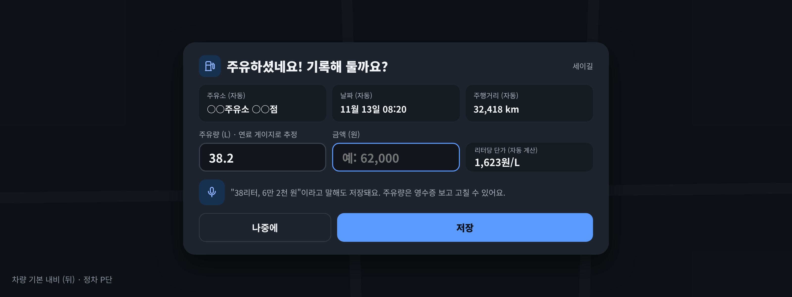
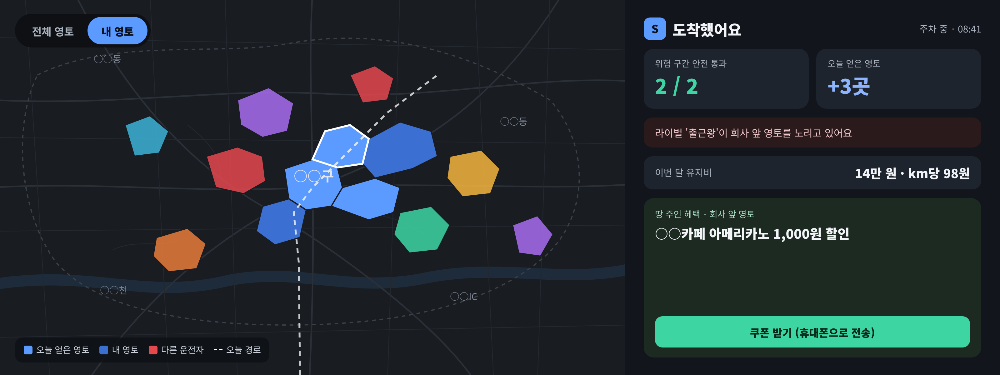

# 세이길 (SayGil)

**Safe하게, Say해주는 길.** 공공 사고데이터와 차량 데이터로 위험의 이유와 행동을 알려주는 Pleos Connect 앱

세이길은 사고다발구간에 들어가기 전에 "어떤 사고가 났고, 지금 무엇을 해야 하는지"를 음성으로 알려주고, 안전하게 지나갈수록 내 영토가 넓어지는 Pleos Connect 안전운전 앱입니다.

> **이름의 의미**: Safe + 길 = "안전하게 지나가는 길", Say + 길 = "위험한 이유를 말해주는 길"
> 위험을 말해주고(Say), 그래서 안전하게 지나가는(Safe) 길을 만드는 것이 세이길의 목표입니다.

현대자동차그룹 차량용 앱 개발 공모전(Pleos Playground) 출품작입니다.

---

## 시연 영상 (52초)



고화질 영상: [docs/saygil-demo.mp4](docs/saygil-demo.mp4)

## 왜 만들었나

| 지금의 안내 | 세이길 |
| --- | --- |
| "사고다발구간입니다"에서 끝남 | 어떤 사고였는지 + 지금 할 행동 1개까지 |
| 매일 같은 경고 → 흘려듣게 됨 | 익숙한 길은 짧게 한 번, 처음 가는 길은 자세히 |
| 여름에도 결빙 경고 | 사고가 주로 난 시간대, 날씨일 때만 |
| 공공 사고데이터는 운전 중에 쓰이지 않음 | 도로교통공단 사고다발지역 데이터를 운전 중 안내로 연결 |

## 화면 시안

차량 내비는 그대로 전체 화면으로 쓰고, 세이길은 필요한 순간에만 나타납니다.

| ① 출발 전 브리핑 (P단) | ② 주행 중 1km 전: 알림 배너 |
| --- | --- |
|  |  |
| **③ 300m 전: 화면 분할 (통과 후 자동 복귀)** | **④ 주유 직후: 자동 감지 기록 팝업** |
|  |  |

**⑤ 도착, 주차: 안전 통과 결과와 실제 지도 위 영토**



전체 시안: [docs/saygil-screens.pdf](docs/saygil-screens.pdf)

## 핵심 기능

1. **사고 맥락 안내 (핵심)**: `[어디] + [어떤 사고] + [지금 할 행동 1개]`
   - 3단계 타이밍: 출발 전 브리핑 → 1km 전 배너 → 300m 전 화면 분할 → 통과 후 피드백
   - 내 속도가 빠르면 한 번 더 강하게, 천천히 가면 짧게
2. **주유, 충전 자동 감지 기록**: 재시동 시 연료량 변화와 주유구, 위치로 주유를 감지해 주유량을 미리 채운 기록 팝업 표시 (금액만 입력하거나 말로 입력)
3. **안전 영토전**: 많이 달린 사람이 아니라 전비(연비) 좋게, 위험 구간을 안전하게 지난 사람이 동네 영토를 차지

## 지금 구현된 것: 안내 엔진 (`engine/`)

차량 없이도 돌아가는 Kotlin 핵심 로직입니다. 이후 Pleos Connect 앱에 그대로 붙일 수 있도록 순수 Kotlin으로 분리했습니다.

| 파일 | 하는 일 |
| --- | --- |
| [`GuidanceEngine.kt`](engine/src/main/kotlin/saygil/engine/GuidanceEngine.kt) | 사고유형, 시간, 기온, 속도, 거리, 익숙한 길 여부로 "안내할지 말지"와 안내 문장 결정 |
| [`ZoneFinder.kt`](engine/src/main/kotlin/saygil/engine/ZoneFinder.kt) | 내비 경로를 받을 수 없을 때 진행 방향 앞쪽 2km 안의 사고다발구간 찾기 |
| [`FuelDetector.kt`](engine/src/main/kotlin/saygil/engine/FuelDetector.kt) | 시동 전후 연료량 비교로 주유 감지, 주유량과 리터당 단가 계산 |
| [`Demo.kt`](engine/src/main/kotlin/saygil/engine/Demo.kt) | 겨울 출근길 시나리오 데모 |

### 데모 실행 결과

```
[07:52 다리 1km 전, 영하 3도, 70km]
  BANNER · 강하게: 1km 앞 ○○교, 사고다발구간이에요. 이 다리는 결빙이 잘 생기는 구간이에요. 지금 70km에서 40km로 속도를 줄여주세요.
[같은 다리, 7월(기온 25도)]
  (안내 안 함)
[08:05 매일 지나는 초등학교 앞 300m]
  SPLIT: 어린이 주의, 우회전 전에 꼭 멈추세요
[15:30 처음 가는 초등학교 앞 300m, 하교 시간]
  SPLIT · 강하게: 곧 사고다발구간이에요. 여기는 어린이 횡단보도 사고가 많았어요. 우회전 전에 꼭 멈추세요.
[22:00 같은 초등학교 앞, 밤]
  (안내 안 함)
[내비 경로 없이 앞쪽 2km 예측 (북쪽으로 주행)]
  ○○교: 556m
  ○○초 사거리: 1668m
[주유 감지]
  주유량 추정: 38.3L, 6만 2천 원 → 리터당 1619원
```

### 실행 방법

```bash
cd engine
gradle test   # 단위 테스트 12개
gradle run    # 시나리오 데모
```

## Pleos Connect SDK, API 사용 계획

| SDK / 데이터 | 쓰는 정보 | 쓰이는 기능 |
| --- | --- | --- |
| Vehicle SDK | 시동, 기어(P/D), 브레이크, 전기차 배터리 잔량 | 주행과 정차 판단, 충전 감지, 팝업 시점 |
| AAOS 차량 속성 | 차속, 연료량, 주유구 열림 | 안내 강도, 급감속 감지, 주유 감지 |
| Fused Location SDK | 위치, 진행 방향 | 사고다발구간 접근 판단, 영토 |
| NaviHelper SDK | 순정 내비 목적지와 경로 | 출발 전 브리핑, 경로 위 구간 사전 계산 |
| Gleo AI SDK (STT, TTS, LLM) | 음성 입출력 | 안내 음성, 주유 금액 음성 입력 |
| 도로교통공단 사고다발지역 데이터 | 사고유형, 사상자 수, 위치 | 안내 카드 원천 데이터 |
| 기상청 날씨 API | 기온, 강수 | 결빙 안내 조건 |

순정 내비가 아닌 내비(네이버지도, 카카오내비, 휴대폰 연결)를 쓸 때는 `ZoneFinder`로 진행 방향 앞쪽 구간을 예측해 안내합니다.

## 로드맵

- [x] 기획, 화면 시안
- [x] 안내 엔진, 주유 감지 로직 + 단위 테스트
- [ ] Pleos Connect 에뮬레이터에서 동작하는 앱 (안내 배너, 화면 분할, 주유 팝업)
- [ ] 공공 사고데이터 수집 서버, 안내 카드 가공
- [ ] 영토전, 동네 혜택

> 화면 시안과 데모의 장소, 시간, 금액은 이해를 돕기 위한 예시입니다.
